<div align="center">

# ✠ IMPERIUM ✠

### Uma apresentação cinematográfica das facções do Imperium da Humanidade

Animações 3D feitas só com **HTML + CSS**, construídas em **Angular 22 sem zone.js**, pensadas **primeiro para o celular**.

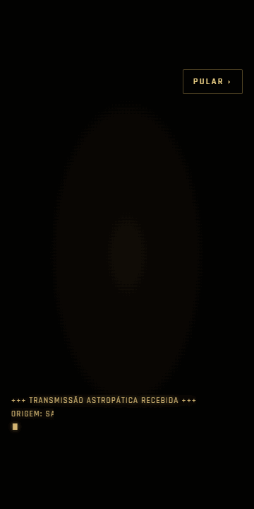
&nbsp;&nbsp;
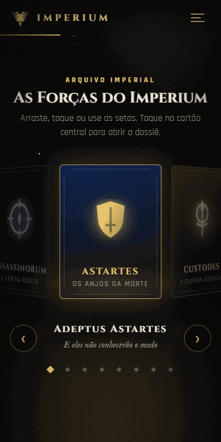
&nbsp;&nbsp;
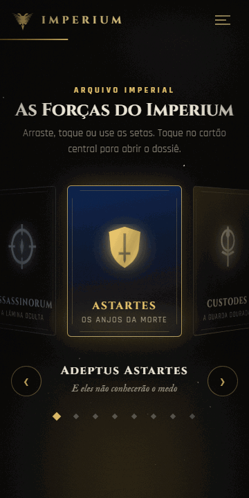

<sub>Abertura · Carrossel 3D · Transição para o dossiê</sub>

</div>

---

## 📱 Capturas no celular

| Abertura | Início | Carrossel 3D | Menu |
| :---: | :---: | :---: | :---: |
| 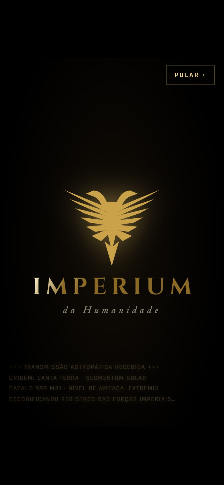 | 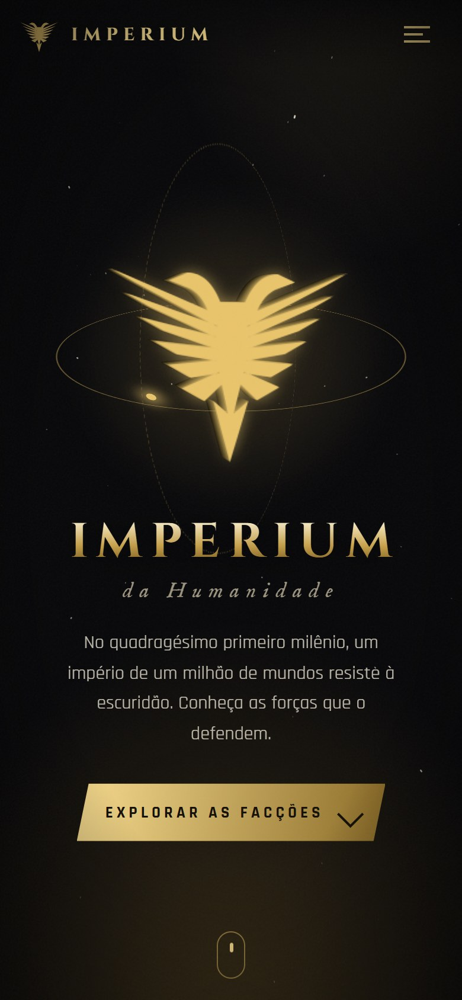 | 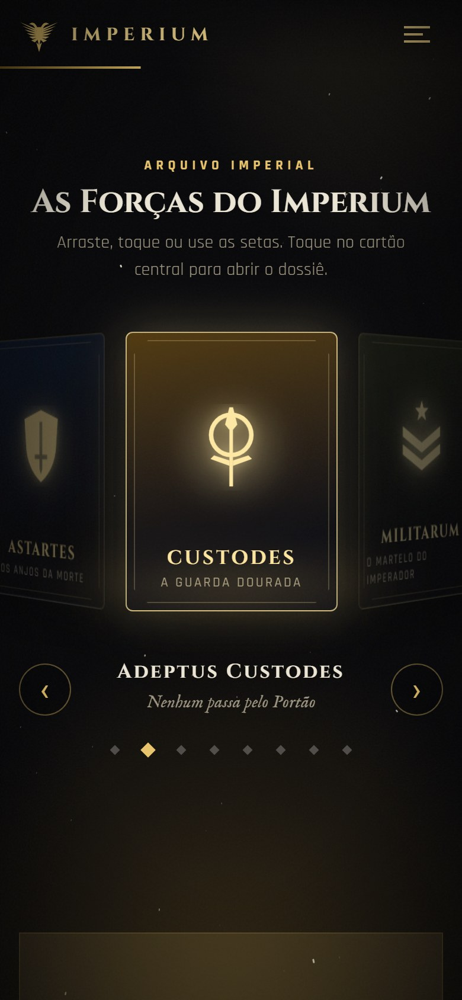 | 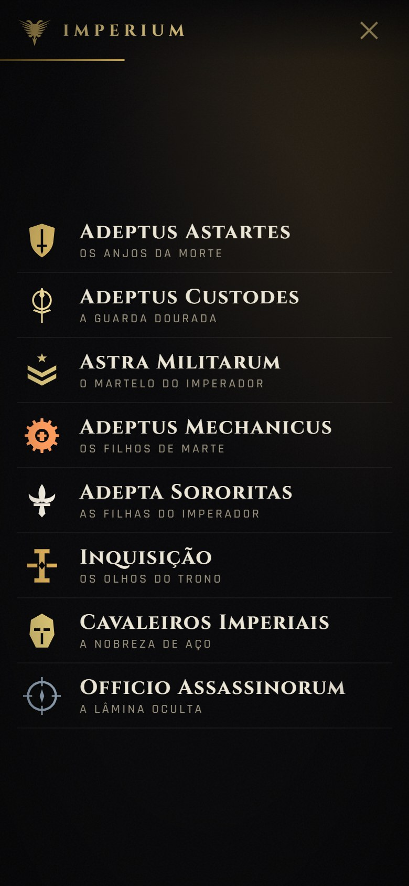 |

| Dossiê da facção | Atributos | Linha do tempo |
| :---: | :---: | :---: |
| 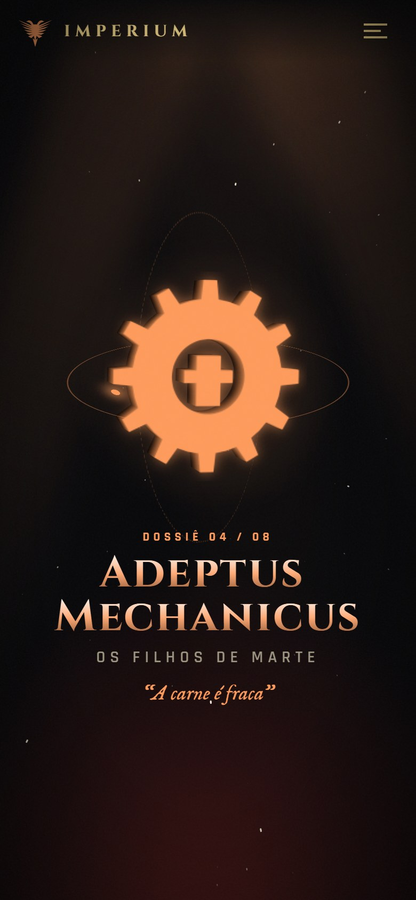 | 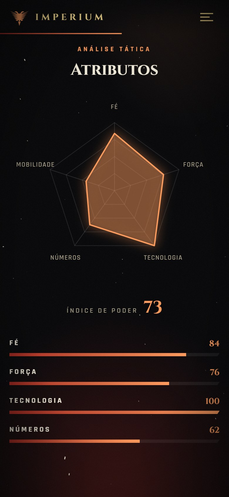 | 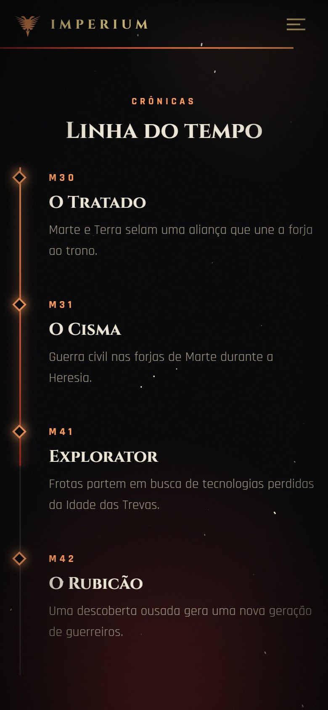 |

## 🖥️ Capturas no desktop

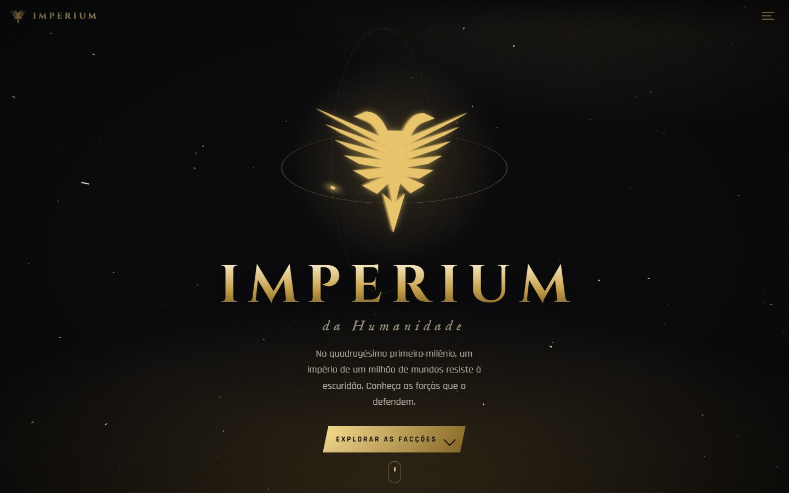

| Carrossel | Dossiê |
| :---: | :---: |
| 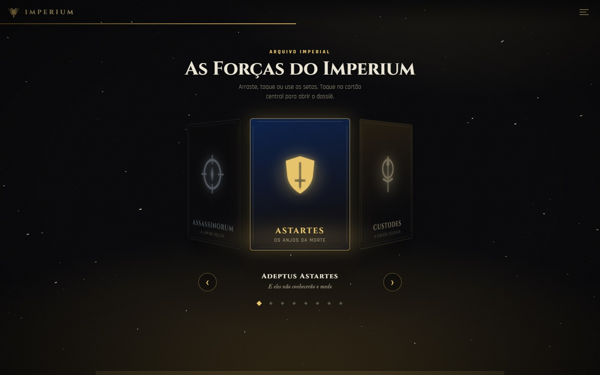 | 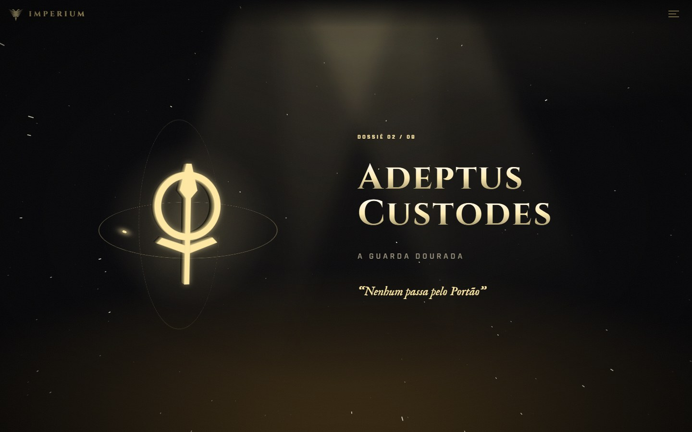 |

---

## ✨ O que tem no site

- **Abertura de cinema:** faixas pretas, transmissão digitada, o título surgindo letra por letra com um brilho passando e saída em zoom. Toque ou `Esc` pula. Aparece uma vez por sessão.
- **Campo estelar em `<canvas>`:** as estrelas vêm em direção à tela e, a cada troca de página, viram riscos como num salto no espaço, já na cor da facção.
- **Emblemas 3D só com CSS:** o mesmo símbolo empilhado em até 20 camadas com `translateZ`, com anéis em órbita, halo e reflexo metálico. Seguem o mouse e, no celular, o giroscópio.
- **Carrossel em anel 3D:** arrastar com o dedo, setas do teclado e giro automático que pausa quando você interage.
- **Transição entre páginas:** o emblema do cartão "voa" até a página da facção (View Transitions API) e o site inteiro muda de cor.
- **Dossiê de cada facção:** título com efeito de falha digital, citação digitada, gráfico de radar gerado a partir dos dados, barras que se enchem, cartões com inclinação e reflexo, e linha do tempo ligada à rolagem.
- **Efeitos de rolagem só com CSS** (`animation-timeline`): barra de progresso de leitura, hero que some ao rolar e linha do tempo.
- Granulado de filme e vinheta por cima de tudo.

## 🅰️ Angular levado ao limite

| Recurso | Onde |
| --- | --- |
| Sem zone.js + `OnPush` em tudo | todo o app |
| `signal`, `computed`, `effect` | serviços, páginas e componentes |
| `input()` / `output()` / `viewChild()` | componentes e diretivas |
| `@defer (on viewport; prefetch on idle)` | grade de facções e linha do tempo |
| `@for`, `@if`, `@switch`, `@let` | templates |
| `withViewTransitions` + `onViewTransitionCreated` | `app.config.ts` |
| `withComponentInputBinding` (`:slug` vira `input()`) | `pages/faction.ts` |
| Rotas lazy, `canMatch` e título por resolver | `app.routes.ts` |
| Diretivas próprias: revelar, inclinar 3D e contador | `directives/` |
| Eventos de alta frequência fora da detecção de mudanças | `TiltDirective`, `MotionService`, `StarfieldComponent` |

**Acessibilidade e desempenho:** respeita `prefers-reduced-motion`, pausa o canvas com a aba oculta, ajusta a quantidade de estrelas ao tamanho da tela, e o primeiro carregamento tem cerca de **84 kB** comprimidos.

## 🚀 Como rodar

```bash
npm install
npm start          # http://localhost:4200
npm run build      # versão de produção em dist/
```

### Atualizar as capturas e GIFs deste README

As imagens em `docs/screenshots/` são geradas por um script (Chrome headless + Puppeteer):

```bash
npm start -- --port 4300   # em um terminal
npm run capture            # em outro
```

Variáveis opcionais: `BASE_URL` (padrão `http://localhost:4300`) e `CHROME_PATH` (caminho do Chrome, se não for encontrado sozinho).

## 🗂️ Estrutura

```
src/app/
├── core/          MotionService (ponteiro, giroscópio, movimento reduzido) e ThemeService (cores)
├── data/          factions.ts: conteúdo das 8 facções
├── components/    starfield, intro, emblem-3d, glyph, ring-carousel, nav, typewriter
├── directives/    reveal, tilt, counter
└── pages/         home, faction, not-found
scripts/capture.mjs   gera as imagens do README
```

## 🌐 Compatibilidade

Funciona em todos os navegadores modernos. Os efeitos ligados à rolagem e a transição entre páginas usam recursos que o **Firefox** ainda não tem: nele o site funciona normalmente, só sem esses efeitos. No **iPhone**, os emblemas usam só o movimento automático, porque o giroscópio exige um pedido de permissão que ainda não foi implementado.

---

<sub>Projeto de fã, não oficial e sem fins lucrativos. Warhammer 40,000 e nomes relacionados pertencem à Games Workshop. Símbolos e textos deste site são criações originais inspiradas no universo.</sub>
